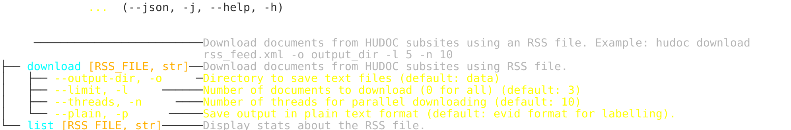

[](https://github.com/evidlabel/hudoc/actions/workflows/ci.yml)
[](https://github.com/evidlabel/hudoc/releases)
[](https://www.python.org/downloads/)
[](https://opensource.org/licenses/MIT)

# hudoc

CLI tool for downloading ECHR and GREVIO HUDOC documents.

Agent-oriented usage: see **[`SKILL.md`](SKILL.md)** in this directory.

## Installation

Prefer using [uv](https://docs.astral.sh/uv/) for installation:

```sh
uv pip install .
```

## Usage



Fetch one latest ECtHR document (live HUDOC query):

```sh
hudoc latest -s echr -l 1 -n 1 --plain true
```

Same as `sh examples/latest.sh`.

## License

This project is licensed under the [MIT License](LICENSE).
