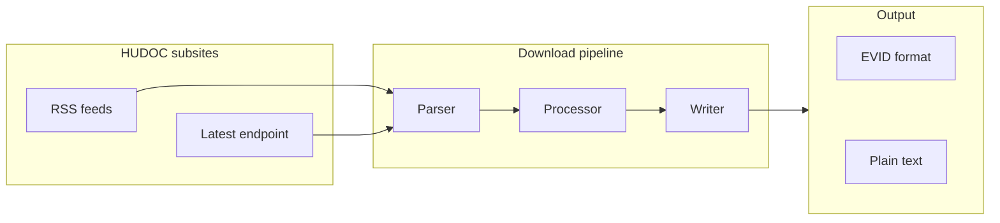

# hudoc — HUDOC Document Downloader

**hudoc** is a command-line tool for downloading legal documents from [HUDOC](https://hudoc.echr.coe.int/), the official case law database of the European Court of Human Rights (ECtHR) and other Council of Europe monitoring bodies.

## What It Does

- **Download** case documents from any HUDOC subsite via RSS feed URLs
- **Fetch the latest** decisions directly by subsite name (no RSS file needed)
- **Inspect** RSS feeds to preview available documents before downloading
- **Parallel downloads** with configurable thread count for bulk operations
- **Two output formats**: evidence-style (default, for labelling) or plain text

## Architecture



## Supported HUDOC Subsities

| Subsite | Body |
|---------|------|
| `echr` | European Court of Human Rights |
| `exec` | Executive Committee of the Committee of Ministers |
| `greco` | Group of States against Corruption |
| `greta` | European Committee for the Prevention of Torture |
| `grevio` | Group of Experts on Action against Violence against Women |
| `esc` | European Social Charter (Committee of Experts) |
| `ecri` | European Commission against Racism and Intolerance |
| `ecrml` | European Commission against Racism and Intolerance (ML) |
| `commhr` | Committee on the Rights of Humans |
| `cpt` | Committee for the Prevention of Torture |
| `fcnm` | Framework Convention for the Protection of National Minorities |

## Quick Start

```bash
# Install
pip install hudoc

# Download from an RSS feed
hudoc download my_feed.xml -o ./cases -l 10

# Fetch the latest ECtHR decisions
hudoc latest -s echr -l 5
```

See the **Guides** section for detailed workflows or **Reference** for the full CLI reference.